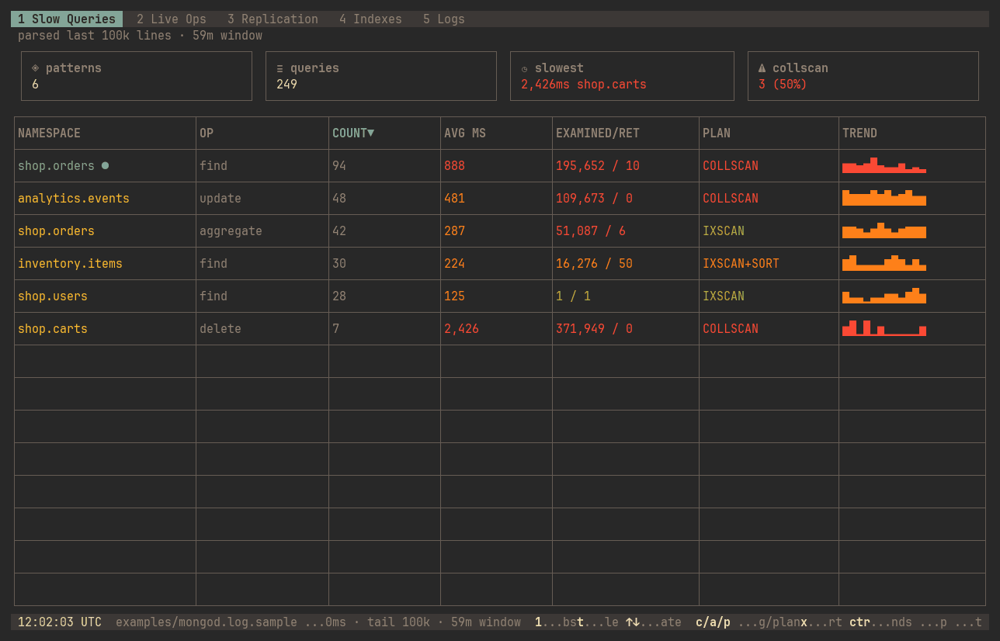

# MongoScope

[](https://github.com/prodioslabs/mongoscope/releases)
[](./LICENSE)
[](https://mongoscope.prodioslabs.in/docs)

**See which MongoDB queries are killing your latency—without leaving the terminal.**

```bash
curl -fsSL https://raw.githubusercontent.com/prodioslabs/mongoscope/main/install.sh | bash
```



MongoScope groups slow queries in a `mongod` log by shape, ranks them by count, latency, and plan, and shows live ops, replica lag, indexes, and log tails in one keyboard-driven TUI. Linux and macOS install with the script above; Windows uses the release `.zip` ([Install](#install)).

[Documentation](https://mongoscope.prodioslabs.in/docs) · [Releases](https://github.com/prodioslabs/mongoscope/releases) · [Contributing](./CONTRIBUTING.md)

## Try it on a sample log

No MongoDB log handy? Download the synthetic sample (one hour of fake `shop` and `analytics` traffic) and open it:

```bash
curl -fsSLO https://raw.githubusercontent.com/prodioslabs/mongoscope/main/examples/mongod.log.sample
mongoscope --log-path mongod.log.sample
```

Press `Enter` on a pattern for the query detail, `5` for Logs, `q` to quit.

## Why MongoScope

| You have                                  | MongoScope gives you                                                                                                                              |
| ----------------------------------------- | ------------------------------------------------------------------------------------------------------------------------------------------------- |
| A `mongod.log` from an incident           | Slow queries grouped by shape, with count, avg ms, examined/returned, plan, trend, and History (early vs late, plan changes, logged index events) |
| A shell on the database host and no GUI   | A single binary with no runtime to install; runs in any terminal, including over SSH                                                              |
| Self-hosted MongoDB without Atlas tooling | Log and `system.profile` analysis that needs only file access or a connection string                                                              |
| A live incident                           | `currentOp` with COLLSCAN highlights and kill-op, replica lag and elections, index build progress                                                 |

## What you get

| Area         | What it surfaces                                                                                                 |
| ------------ | ---------------------------------------------------------------------------------------------------------------- |
| Slow Queries | Aggregated patterns from logs or live `system.profile`; History compare on static logs; export JSON/CSV/Markdown |
| Live Ops     | `currentOp`, COLLSCAN highlights, kill-op, collection `top`                                                      |
| Replication  | Topology, oplog window, lag sparkline, heartbeats, elections                                                     |
| Indexes      | Inventory, build %, `$indexStats`, jump from a slow query                                                        |
| Logs         | File tail or rolling `getLog` buffer from a live connection                                                      |

Connections land in your OS keychain (`Bun.secrets`) when available, otherwise plaintext under `secrets` in `~/.config/mongoscope/config.json`. Themes (gruvbox, catppuccin, nord, …) persist in that same config directory.

## Quick start

1. Run `mongoscope` in a real interactive terminal (do not pipe stdout).
2. On the Welcome screen, pick a log from `/var/log/mongodb` or your `--log-dir` (default `.`).
3. Press `Enter`. MongoScope parses the last 100k lines and opens the dashboard on **Slow Queries**.

For live tabs, press `2` (Live Ops) and fill in the inline add form, use `Ctrl+K` → Manage connections, or start with `mongoscope --uri mongodb://localhost:27017` for a session-only connect. See [Connections](https://mongoscope.prodioslabs.in/docs/connections).

If `/var/log/mongodb` is root-owned, Welcome offers **retry with sudo** (`r`): a short-lived `sudo ls` / `sudo tail`, while the app itself never runs as root. See [Permissions and elevated access](https://mongoscope.prodioslabs.in/docs/getting-started#permissions-and-elevated-access).

| Key                       | Action                                           |
| ------------------------- | ------------------------------------------------ |
| `1`–`5` / Tab / Shift+Tab | Switch tabs                                      |
| `c`                       | Connections (Live Ops / Replication / Indexes)   |
| `l`                       | Toggle Static ↔ Live (Slow Queries / Logs)       |
| `x`                       | Export Slow Queries patterns (JSON/CSV/Markdown) |
| `?`                       | Help                                             |
| `Ctrl+K`                  | Command palette                                  |
| `m` / `t`                 | Light-dark / cycle theme                         |
| `q`                       | Quit                                             |

Full reference: [Keyboard shortcuts](https://mongoscope.prodioslabs.in/docs/shortcuts).

## Install

| Method              | Command / notes                                                                                                                                                   |
| ------------------- | ----------------------------------------------------------------------------------------------------------------------------------------------------------------- |
| curl (Linux, macOS) | `curl -fsSL https://raw.githubusercontent.com/prodioslabs/mongoscope/main/install.sh \| bash`                                                                     |
| Pin a version       | `MONGOSCOPE_VERSION=v0.3.0 curl -fsSL … \| bash`                                                                                                                  |
| Custom prefix       | `MONGOSCOPE_PREFIX=$HOME/.local curl -fsSL … \| bash`                                                                                                             |
| Windows x86_64      | Download `mongoscope_<version>_windows_amd64.zip` from [Releases](https://github.com/prodioslabs/mongoscope/releases), unzip, put `mongoscope.exe` on your `PATH` |
| Manual archive      | Linux / macOS `.tar.gz` and `checksums.txt` on [Releases](https://github.com/prodioslabs/mongoscope/releases)                                                     |

The installer downloads the matching archive from GitHub Releases, verifies `checksums.txt`, installs to `/usr/local/bin` (Linux) or `~/.local/bin` (macOS), and runs `mongoscope --version`. Update by re-running it. Details: [Installation](https://mongoscope.prodioslabs.in/docs/installation).

## CLI flags

```bash
mongoscope --help
```

| Flag                                                        | Status                                                                                                |
| ----------------------------------------------------------- | ----------------------------------------------------------------------------------------------------- |
| `-h`, `--help` / `-v`, `--version`                          | Print and exit immediately (`package.json` in dev; `MONGOSCOPE_EMBEDDED_VERSION` in release binaries) |
| `--log-dir`                                                 | Welcome screen’s second log list (default `.`)                                                        |
| `--log-path`                                                | Parse that log file on startup (skips picker; invalid path exits 1)                                   |
| `--uri`                                                     | Ephemeral live connect for this session (not saved to keychain)                                       |
| `--host`, `--port`, `--username`, `--password`, `--auth-db` | Build a URI and ephemeral-connect (do not combine with `--uri`; default port 27017)                   |

## Contributing

Bug reports, fixes, and docs edits are welcome. Start with [CONTRIBUTING.md](./CONTRIBUTING.md) for setup, checks, and the release process, or pick an issue labeled [`good first issue`](https://github.com/prodioslabs/mongoscope/issues?q=is%3Aissue+is%3Aopen+label%3A%22good+first+issue%22).

```bash
git clone https://github.com/prodioslabs/mongoscope.git
cd mongoscope
bun install
bun start --log-path examples/mongod.log.sample
```

Report security issues privately — see [SECURITY.md](./SECURITY.md). Participation follows the [Code of conduct](./CODE_OF_CONDUCT.md).

Built with [Bun](https://bun.sh) and [OpenTUI](https://github.com/anomalyco/opentui).

## License

MIT License — see [LICENSE](./LICENSE) for details.
